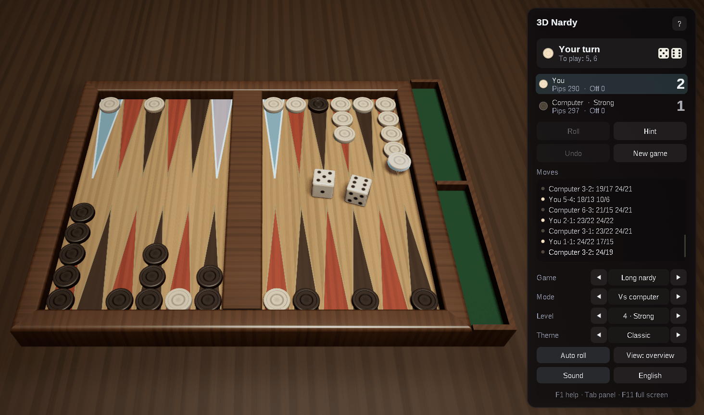
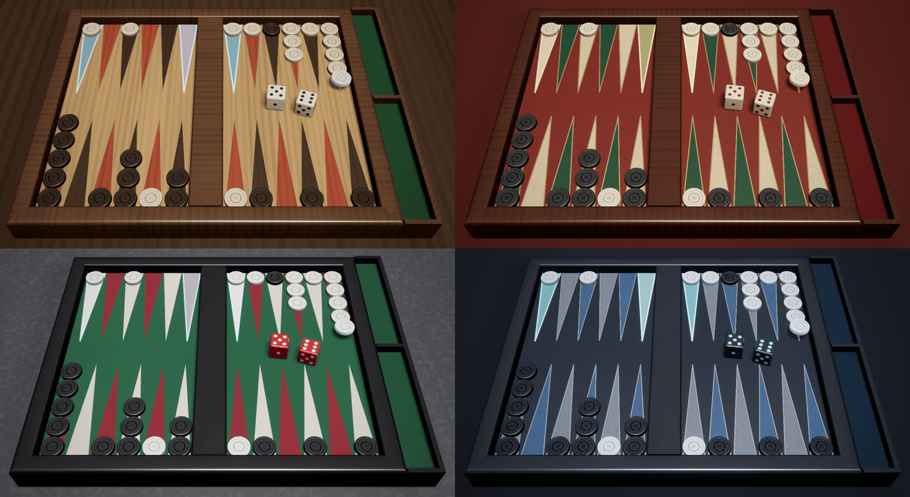

# 3D Nardy for macOS: Swift and Metal

[](https://github.com/sponsors/makarov-mm)
[](LICENSE)


[](https://www.linkedin.com/in/makarov-mm/)
[](https://www.threads.net/@m.m.makarov)
[](https://www.instagram.com/m.m.makarov/)

A 3D nardy game for macOS written in Swift on Metal and AppKit: long nardy, the game of the Caucasus and Central Asia, and short nardy, known in the West as backgammon. The computer opponent judges positions with small neural networks it taught itself by playing millions of games.

There is no game engine and no model, texture or sound file: the board, the checkers and the dice are built in code at startup, the wood, leather, felt and stone are procedural, the lighting environment is baked on the GPU, and the sounds are synthesized. The only frameworks are the ones macOS has: AppKit for the window and the input, Metal and MetalKit for the graphics, Core Text for the text and AVFoundation for the sound. There are no package dependencies.

This is a port of the Windows version written in C++23 on Win32 and OpenGL 4.6. The rules, the networks, the computer player, the scene and the animation follow it exactly, and its GLSL shaders are rewritten in the Metal Shading Language. On the way two flaws of the original were mended: a checker taken from a point where others lay under it began its flight from the checker below it, and the rings of the wooden checkers had a seam where their angle went round.





## Features

### Games

- **Long nardy** (длинные нарды): fifteen checkers each on the «head», both sides running the same way round the board. A single checker holds a point; only one checker may leave the head a turn, two on a first roll of 6-6, 4-4 or 3-3; no six points in a row may be held unless an opponent's checker is already past them. A win is one point, two for a mars, when the opponent has borne off none
- **Short nardy** (короткие нарды, backgammon): the sides run against each other, a lone checker is hit to the bar and must enter the opponent's home before anything else moves. A win is one point, two for a mars (gammon), three for a koks (backgammon)
- Both: a double is played four times, both dice must be played when they can be, the higher one when only one can, and the checkers are borne off once all fifteen are home
- The players throw a die each to see who starts; in short nardy those two dice are the first roll

### The computer player

- Judges every way of playing a roll by the position it leaves: a network of 200 inputs, 64 hidden units and three outputs, the chances of winning, of winning a mars and of losing one. One network for each game, about 50 KB each
- Taught by temporal-difference learning, as TD-Gammon was: it played against itself over a million games of each kind, nudging its judgement of each position toward that of the next. The networks are the Windows version's; the program that taught them is not part of this port
- Five levels, from Novice to Master. The lower levels misjudge on purpose, Novice by much, and now and then plays a random move; Master also looks a roll ahead: for its eight best moves, every one of the 21 rolls the opponent may answer with and the opponent's best reply
- Thinks on a thread of its own, then plays its steps one by one; the hint is Master's advice

### Play

- Click a checker, then where it goes, or drag it there; the places it may reach glow, with one die or several in turn by the same checker, and the dice still to play are listed. A double-click plays the higher die
- Only legal steps are offered, and every step leaves a way to play the whole roll by the rules; clicking a checker that may not move says why: a checker on the bar to bring in first, or the head already left this turn
- Take back a step with a right click or `Delete`, the whole turn with **Undo**, or go back to an earlier turn of yours and play it again with the same dice
- The hint shows the computer's best move on the board and in words; asked for again, it plays it
- The dice thrown with `Space`, a click on the board, the button, or by themselves
- Play against the computer, two players on one Mac, or watch a demo game
- The moves in the notation players write: `24/18`, `13/7*` for a hit, `bar/22`, `6/off`, `13/7(2)`; the pips left and the checkers borne off; the score over the games
- The game in progress, its history and the settings kept between sessions
- Two views: an overview from White's side and one from above. The camera also turns with the right mouse button and zooms with the wheel, two fingers or a pinch
- English and Russian interface and menus, chosen from the system language
- Sounds mixed as they play: dice shaken and bouncing, checkers set down, knocked off and dropped into the tray
- Full screen, and sharp on Retina displays: the interface and the text follow the scale of the screen the window is on
- Shortcuts work in any keyboard layout: by their letters in Latin layouts, by their places in others, such as the Russian one
- No work while nothing moves: the view stops drawing until something changes, and while the window is out of sight

### Graphics

- Physically based shading: GGX highlights, a clear coat on the checkers, the dice and the box, image-based lighting from a procedural room with a lamp over the board
- Soft shadows (PCSS); HDR rendering with 4x MSAA, bloom, ACES tone mapping and vignette
- A board of two fields with the points inlaid and edged with a thin line, drawn by the shader and filtered over each pixel; mitred rims, the middle bar, and a tray beside it where the checkers borne off stand on edge
- Checkers turned of wood, stone, bone or plastic, with a raised rim, a carved groove and a rosette; dice with rounded edges and sunken pips
- Animation: the dice thrown across the board, bouncing and tumbling to rest on the numbers rolled and darkening as they are played; checkers flying in arcs, lifted when chosen, a lone one knocked off to the bar, borne off ones turning on edge into the tray
- Marks on the board: where the chosen checker may go, which checkers may move, the last move, and the hint
- Four themes: Classic (a light wooden field with dark and red points in a walnut box, ivory and ebony checkers), Oriental (red leather with a gold line, a lacquered box, bone and onyx), Tournament (green felt, black lacquer, red precision dice) and Night (dark leather, slate points and a silver line, pearl and black stone)
- An interface of frosted-glass panels

## Controls

| Action | Control |
|---|---|
| Choose a checker, then where it goes | Click |
| Move a checker | Drag it |
| Play the higher die | Double-click the checker |
| Take back a step | Right click (a secondary click on a trackpad, or Control-click), `Delete` |
| Undo the turn | `⌘Z`, the **Undo** button |
| Roll the dice; end the turn at once | `Space`, `Return` |
| Hint; again to play it | `H` |
| Roll by itself | `A` |
| Turn the view | Drag with the right mouse button, or on an empty part of the board |
| Zoom | Scroll, or pinch on a trackpad |
| Next view; reset it | `C`; `Home` |
| New game | `N`, `⌘N` |
| Long or short nardy | `G` |
| Who plays | `M` (`⇧M` back) |
| Computer level | `1` … `5` |
| Next theme | `T` (`⇧T` back) |
| Sound on / off | `V` |
| English / Russian | `L` |
| Show / hide the panel | `Tab` |
| Full screen | `⌃⌘F`, `F11`, `⌥Return` |
| Help and the rules | `F1`, `⌘?` |
| Let go of the checker; leave full screen | `Esc` |

A new game starts at once when the game is changed; changing the game or who plays starts the score again. The Control key works in place of Command in the shortcuts of the game, as Ctrl does on Windows.

## Requirements

- macOS 13 Ventura or newer, on Apple silicon or Intel
- Xcode 16 or newer, or its Command Line Tools: Swift 6 is needed to build

## Building and running

In the project's folder:

```sh
./build.sh          # builds build/3D Nardy.app
./build.sh run      # builds it and starts it
./build.sh clean    # removes the build output
```

The application is signed ad hoc, for the Mac it was built on; drag it to the Applications folder to keep it.

For a quick start without the application bundle:

```sh
swift run -c release
```

The settings and the game in progress are kept in the user defaults (`defaults read com.makarovmm.nardy3d`).

## Project structure

```text
.
├── Package.swift                the Swift package: one executable; the shaders, the networks and the icon as resources
├── build.sh                     builds and signs the application bundle
└── Sources/Nardy3D/
    ├── App/                     the application: the window, the menus, the view, the game flow, input and interface
    ├── Rules/                   the rules of long and short nardy: the legal ways to play a roll, the end of the game
    ├── Computer/                the network that judges positions, the computer player and the thread it thinks on
    ├── Scene/                   the board's measurements and meshes, the checkers and the dice as drawn, the camera,
    │                            the themes
    ├── Rendering/               the rendering pipeline: render targets, light probes, uniforms and the passes
    ├── Interface/               font atlases drawn with Core Text, drawing of the interface
    ├── Support/                 the settings, the texts in English and Russian, synthesized sounds and their mixer,
    │                            the random numbers, the resources
    └── Resources/
        ├── Shaders/             Metal shaders, compiled when the game starts
        ├── long.net, short.net  the computer player's networks
        └── nardy3d.png          the icon
```

## How a frame is drawn

1. **Shadow map**: the box and every checker and die seen from the lamp's key light, for soft shadows; the checkers and the dice in two instanced draws.
2. **Main pass**: the table, the box, the felt of the tray and the fields in HDR with 4x MSAA, lit by the key light and the baked environment. The points, their lines and the marks of the game are drawn on the fields by their shader, filtered over each pixel. The checkers and the dice follow in two instanced draws, then the room behind.
3. **Post-processing**: the samples are resolved, bright parts spread into a six-level bloom, and the composite pass applies tone mapping and vignetting and frosts the glass behind the interface panels.
4. **Interface**: panels, text and icons, drawn on top.

The environment maps are baked with compute kernels when the theme changes, and the BRDF table once at startup.

## License

MIT License

Copyright (c) 2026 Mykhailo Makarov

Permission is hereby granted, free of charge, to any person obtaining a copy
of this software and associated documentation files (the "Software"), to deal
in the Software without restriction, including without limitation the rights
to use, copy, modify, merge, publish, distribute, sublicense, and/or sell
copies of the Software, and to permit persons to whom the Software is
furnished to do so, subject to the following conditions:

The above copyright notice and this permission notice shall be included in all
copies or substantial portions of the Software.

THE SOFTWARE IS PROVIDED "AS IS", WITHOUT WARRANTY OF ANY KIND, EXPRESS OR
IMPLIED, INCLUDING BUT NOT LIMITED TO THE WARRANTIES OF MERCHANTABILITY,
FITNESS FOR A PARTICULAR PURPOSE AND NONINFRINGEMENT. IN NO EVENT SHALL THE
AUTHORS OR COPYRIGHT HOLDERS BE LIABLE FOR ANY CLAIM, DAMAGES OR OTHER
LIABILITY, WHETHER IN AN ACTION OF CONTRACT, TORT OR OTHERWISE, ARISING FROM,
OUT OF OR IN CONNECTION WITH THE SOFTWARE OR THE USE OR OTHER DEALINGS IN THE
SOFTWARE.

## Support

If you found this project interesting or useful, you can support my work:

[](https://github.com/sponsors/makarov-mm)
